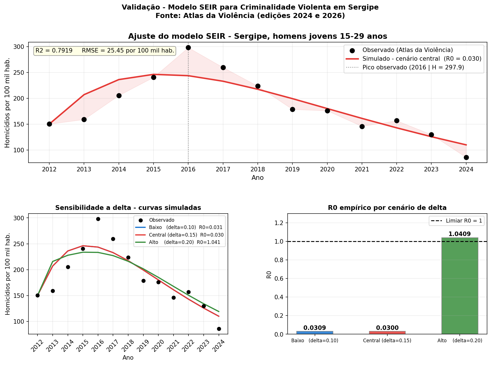

# Modelagem SEIR da Dinâmica de Homicídios em Sergipe

Adaptação de um modelo epidemiológico compartimental (SEIR) para descrever a
dinâmica temporal da criminalidade violenta entre homens jovens (15–29 anos)
em Sergipe (2012–2024), com derivação analítica completa e calibração contra
dados reais do **Atlas da Violência**.

## O problema

Modelos SEIR (Suscetíveis–Expostos–Infectados–Removidos) descrevem como uma
condição se propaga por contágio numa população. Aqui, a hipótese testada é
se a dinâmica de homicídios de jovens pode ser descrita por um mecanismo
análogo: exposição ao ambiente criminal (facções, pequenos delitos) seguida
de progressão para atividade homicida ativa.

- **S**usceptíveis: jovens vulneráveis, ainda sem contato direto com o meio criminal.
- **E**xpostos: já tiveram contato com o ambiente criminal, mas não estão ativos.
- **I**nfratores: potencialmente envolvidos em homicídios — a taxa observada
  `H(t)` é usada como *proxy* de `I(t)`.
- **R**emovidos: saíram do ciclo por ressocialização, prisão de longa pena ou
  morte em confronto.

## Abordagem

1. **Modelo**: sistema de 4 EDOs não lineares, com taxa de contágio social
   `β`, progressão `σ`, ressocialização `γ` e letalidade `δ`.
2. **Análise analítica** (derivação completa em
   [`report/SEIR.pdf`](report/SEIR.pdf)):
   - Dois equilíbrios: livre de homicídio (ELH) e endêmico (EE).
   - `R₀` obtido pelo método da **matriz de próxima geração**.
   - Estabilidade local de cada equilíbrio provada via **critério de
     Routh-Hurwitz** (grau 2 no ELH, grau 3 no EE — usando a desigualdade
     das médias aritmética-geométrica para fechar a condição do caso cúbico).
   - Bifurcação transcrítica em `R₀ = 1`.
3. **Calibração computacional**: os 4 parâmetros livres (`β, σ, γ, E₀`) são
   estimados minimizando o erro quadrático entre `H_sim(t)` e os dados
   observados, em dois estágios — busca global por **Differential
   Evolution** seguida de refinamento local por **Nelder-Mead** — com
   integração do sistema por **Runge-Kutta de 4ª ordem**. O parâmetro `δ`
   é fixado externamente e testado em três cenários de sensibilidade.

## Resultado principal: uma solução de canto

A calibração converge com `β̂` e `γ̂` colados no limite inferior da busca —
não é ruído numérico: o perfil da função objetivo foi verificado e decresce
monotonicamente conforme `β → 0`. Isso significa que **a série histórica de
Sergipe (2012–2024) não identifica um mecanismo de contágio social**: os
dados são explicados de forma estatisticamente superior por uma simples
relaxação a partir de um estoque inicial elevado de vulnerabilidade
(`E₀ ≈ 765`) do que por dinâmica epidêmica.

| Cenário | δ | R₀ empírico | R² | RMSE |
|---|---|---|---|---|
| Baixo | 0,10 | 0,031 | 0,792 | 25,45 |
| Central | 0,15 | 0,030 | 0,792 | 25,45 |
| Alto | 0,20 | 1,041 | 0,721 | 29,45 |

O cenário Alto cruza o limiar endêmico (R₀ > 1), mas com ajuste pior — outra
solução de canto, no sentido oposto — reforçando que o regime `R₀ < 1` é
estatisticamente mais compatível com os dados.



## Limitações (assumidas explicitamente)

- **Não-identificabilidade**: com 13 pontos observados e 4 parâmetros
  livres, `β`, `σ` e `γ` não são identificáveis individualmente — só `R₀`
  como grandeza combinada preserva alguma robustez interpretativa.
- **Sem validação fora da amostra**: os 13 anos completos foram usados na
  calibração; um holdout temporal fortaleceria a validação do ajuste.
- **δ fixado por hipótese de literatura**, sem dado local para Sergipe.
- **Sem reincidência, sem heterogeneidade territorial, parâmetros
  constantes no tempo** — simplificações documentadas e discutidas no
  relatório completo.
- **Leitura crítica**: a hipótese de homogeneidade populacional do modelo
  clássico invisibiliza desigualdades estruturais (raciais, territoriais)
  que caracterizam a violência letal no estado — o relatório completo
  discute por que isso torna o modelo, apesar de matematicamente
  consistente, inadequado como base isolada para políticas públicas.

## Estrutura do repositório

```
.
├── src/
│   └── seir_model.py       # modelo, integração RK4, calibração e visualização
├── data/
│   └── homicidios_sergipe.csv   # série observada (Atlas da Violência, 2012-2024)
├── results/
│   └── seir_validacao_sergipe.png
├── report/
│   └── SEIR.pdf             # relatório completo (derivação analítica + discussão)
└── README.md
```

## Como rodar

```bash
cd src
python3 seir_model.py
```

Requer Python 3.10+, `numpy`, `scipy` e `matplotlib`.

## Nota sobre autoria

Implementação desenvolvida por mim com revisão e correção assistida por IA
sobre o código próprio. A derivação analítica (equilíbrios, R₀,
Routh-Hurwitz) e a interpretação dos resultados no relatório são de minha
autoria integral.

## Autor

Marcos Vinicius Silva dos Santos — Departamento de Matemática, Universidade
Federal de Sergipe.

## Referências principais

Kermack & McKendrick (1927, modelo SIR original) · Van den Driessche &
Watmough (2002, matriz de próxima geração) · Storn & Price (1995,
Differential Evolution) · Nelder & Mead (1965) · Raimundo et al. (2023) e
Sooknanan & Seemungal (2023), aplicações de modelos epidemiológicos a
criminalidade. Lista completa (18 referências) em
[`report/SEIR.pdf`](report/SEIR.pdf).
